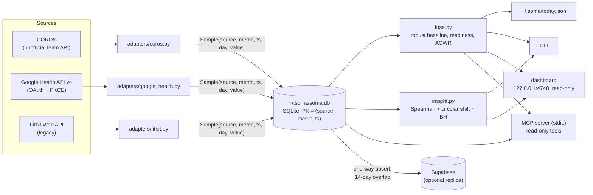

# soma

A local-first store for wearable data. soma pulls COROS and Google Health
(Fitbit) data into one SQLite file under a single canonical vocabulary,
computes a robust daily readiness estimate, and exposes everything through a
CLI, a read-only MCP server, a local dashboard and a plain JSON file.

## Why

Each wearable has its own dialect (COROS reports calories in thousandths of a
kcal, Fitbit nests `dailyRmssd` two levels deep, Google Health sends int64
values as strings) and its own app that keeps the data. soma translates every
source once, at the edge, into metrics with a fixed name and unit. Everything
downstream (scoring, statistics, CLI, MCP, dashboard) never needs to know where
a number came from.

Two rules shape the scoring: **no data means no claim** (missing inputs are
excluded and declared, never defaulted), and **your baseline is your own
recent history**, estimated robustly.

## Quickstart

macOS only (credentials live in the macOS Keychain via `security(1)`).
Python 3.10+, standard library only; `pytest` for the tests.

```sh
git clone <this repo> && cd soma
python3 -m pytest tests/              # 68 tests, no network, no credentials

python3 -m soma auth coros            # email + password -> Keychain
python3 -m soma auth google --client-id <id>.apps.googleusercontent.com
python3 -m soma sync                  # fetch, store, write ~/.soma/today.json
python3 -m soma status                # readiness + the facts behind it
python3 -m soma doctor                # what is connected, what is stale, what is missing
python3 -m soma metric sleep.duration_min --days 60
python3 -m soma metrics               # canonical vocabulary + real coverage per source
python3 -m soma events --kind workout
python3 -m soma insight               # pre-registered hypotheses, FDR-controlled
python3 -m soma dashboard             # http://127.0.0.1:4748
```

`bash scripts/install.sh` optionally adds a `~/bin/soma` wrapper, three
LaunchAgents (sync every 15 min over the last 3 days, a deep 90-day sync at
04:20, an always-on dashboard), and registers the MCP server with the
`claude` CLI if present. `scripts/uninstall.sh` removes them and leaves the
data in `~/.soma`.

### Connecting Google Health

The Fitbit Web API was scheduled by Google for shutdown in September 2026;
Fitbit data now goes through the Google Health API, and old tokens do not
carry over. One-time setup in the Google Cloud console: create a project,
enable the Google Health API, configure an External OAuth consent screen with
yourself as test user, create an OAuth client of type "Desktop app" (or "Web
application" with redirect `http://localhost:8731/callback`), and set the
publishing status to **In production**. With the consent screen left in
*Testing*, Google revokes the refresh token after 7 days; soma translates the
resulting `invalid_grant` into this remedy instead of failing silently. The
OAuth flow uses PKCE (S256) and a loopback redirect on port 8731.

The legacy Fitbit Web API adapter (`soma auth fitbit`) is kept for reference.
When Google Health is connected, `soma sync` skips it automatically to avoid
two rows per metric per day.

## How it works



**Store.** Three tables: `signal` (one row per observation, primary key
`(source, metric, ts)`, so re-syncing a period never duplicates and a
corrected value overwrites), `event` (workouts and sleep sessions, keyed by
`<source>:<native id>`), and `sync_state`. The `METRICS` table in
`soma/store.py` is the contract: an adapter cannot write a metric that is not
declared there with its unit. Each observation also carries a local `day`,
and overnight metrics are dated by the wake-up day, reconstructed from the
UTC offsets the API returns rather than from the machine's current time zone.

**Robust baseline.** For a component metric $x$ (sleep duration, nightly
RMSSD, resting HR, sleep efficiency) on day $t$, the baseline uses the
previous 21 days $H_t$, excluding $t$, and requires $|H_t| \ge 5$:

$$
\tilde{x}_t = \operatorname{median}(H_t), \qquad
\hat{\sigma}_t = \max\bigl(1.4826 \cdot \operatorname{median}_{h \in H_t} |h - \tilde{x}_t|,\ 10^{-6}\bigr)
$$

$$
z_t = s \cdot \frac{x_t - \tilde{x}_t}{\hat{\sigma}_t}, \qquad s = \begin{cases} +1 & \text{higher is better} \\ -1 & \text{otherwise (resting HR)} \end{cases}
$$

The factor 1.4826 makes the MAD a consistent estimator of $\sigma$ under
normality, so $z$ reads like a classical z-score, but a few extreme nights
move neither the center nor the scale much (breakdown point 50% versus 0% for
mean and SD).


*Synthetic, seeded data generated by [`docs/robust_baseline.py`](docs/robust_baseline.py)
using soma's own `_median` / `_mad`. After a 3-night disruption, the
mean/SD band widens for three weeks and the classical z-score stops flagging
ordinary low nights; the robust band barely moves.*

**Readiness.** Let $U$ be the components with a usable $z$, with weights
$w$ = 0.35 (sleep duration), 0.30 (HRV), 0.20 (resting HR), 0.15 (sleep
efficiency). The evidence is $E = \sum_{i \in U} w_i$. If $E < 0.4$, soma
reports the available facts and no score. Otherwise

$$
R = \operatorname{round}\Bigl(\operatorname{clip}_{[0,100]}\Bigl(50 + 22 \cdot \frac{\sum_{i \in U} w_i \operatorname{clip}_{[-2,2]}(z_i)}{E}\Bigr)\Bigr)
$$

so $R \in [6, 94]$ in practice, and no single extreme night can dominate. The
posture written to `today.json` is `neutral` when $E < 0.4$, `gentle` for
$R < 38$, `challenging` for $R > 68$, `normal` otherwise.

**Training load.** The acute:chronic workload ratio on day $t$, from daily
summed `training.load` $L$:

$$
\mathrm{ACWR}_t = \frac{\sum_{k=0}^{6} L_{t-k}}{\tfrac{1}{4}\sum_{k=0}^{27} L_{t-k}}
$$

It is reported only with at least 3 training days in the 28-day window
(otherwise a couple of isolated sessions divide by almost zero), and flagged
above 1.5 or below 0.7.

**Insight engine.** `soma insight` tests only a fixed list of 7
hypotheses written before looking at the data, each with a predictor, an
outcome and a lag in days (for example, training load on day $t$ against HRV
on day $t+1$). For each hypothesis with at least 20 paired days it computes
Spearman's $\rho$ (Pearson on mid-ranks), then a deterministic permutation
p-value by circular shifts of the outcome series, which preserves its
autocorrelation:

$$
p = \frac{1 + \#\{\, s \in \{3, \dots, n-3\} : |\rho(x, y^{(s)})| \ge |\rho_{\mathrm{obs}}| \,\}}{1 + S}
$$

where $y^{(s)}$ is $y$ rotated by $s$ days and $S$ the number of valid shifts.
Shifts of 1-2 days are skipped because they leave the pairing almost intact.
Survivors are selected with Benjamini-Hochberg at $q = 0.10$ over all tests
run (largest $k$ with $p_{(k)} \le qk/m$), and the report always states how
many tests were run. The output says "goes together with", never "causes".

**Outputs.** `~/.soma/today.json` holds `day`, `readiness`, `confidence`
(the evidence $E$), per-component value, baseline, z and text, `missing`,
`no_baseline`, `acwr`, `load_note`, `posture`, `hint` and `generated_at`. It
is a file, not an API: any local agent or program can read it, and if soma
stops running the consumer simply sees a stale timestamp. The MCP server
(`python3 -m soma mcp`, JSON-RPC over stdio) exposes four read-only tools:
`soma_today`, `soma_metric`, `soma_metrics`, `soma_events`.

## Key design decisions

| Decision | Trade-off |
|---|---|
| Canonical vocabulary enforced at write time | Adding a metric is a deliberate edit to `METRICS`, not a side effect of a new adapter |
| Median/MAD instead of mean/SD | Less efficient than mean/SD on clean Gaussian data; much more stable after outliers (see figure) |
| Evidence threshold instead of imputing missing components | Early in the morning, before all data arrives, you get facts but no score |
| Pre-registered hypotheses, circular-shift p-values, BH-FDR | Low power with months of daily data; few or no "findings" is the expected honest result |
| Read-only MCP server and dashboard | An LLM or a browser tab cannot alter physiological history |
| SQLite is the source of truth; Supabase replica is one-way | Cloud problems cannot corrupt local history; no multi-device writes |
| `today.json` as the integration point | No versioned API or push notifications; consumers poll a file |
| Secrets in the macOS Keychain | Not portable to Linux/Windows without a different backend |
| Standard library only | Hand-written HTTP, OAuth and statistics code to maintain |

## Adding a device

1. Write `soma/adapters/<name>.py` with `sync(store, days) -> str`.
2. Map native fields onto metrics in `store.METRICS` (add new ones there if needed).
3. Register the source in `soma/__main__.py` (`cmd_sync`, `_default_sources`).

Scoring, CLI, MCP and dashboard work unchanged.

## Status and limitations

- Personal tool, built for and tested on the author's own COROS and Fitbit
  devices. Not packaged (no `pyproject.toml`); run it with `python3 -m soma`.
- macOS only, because of the Keychain backend and LaunchAgents.
- The COROS adapter uses the unofficial API behind the COROS app (md5 password
  login). It can break without notice, and it only exposes activities and
  training load; sleep and HRV come from Google Health.
- The legacy Fitbit adapter targets an API Google announced it would shut
  down in September 2026 and may no longer work.
- The Google Health adapter is tested against recorded response shapes, not
  against the live API in CI.
- The LaunchAgents created by `install.sh` run `sync --cloud`; without
  Supabase configured, the cloud step logs an error on every run.
- Readiness weights and thresholds are hand-chosen, not fitted or validated
  against an outcome. Not a medical device.

## License

MIT, see [LICENSE](LICENSE).
