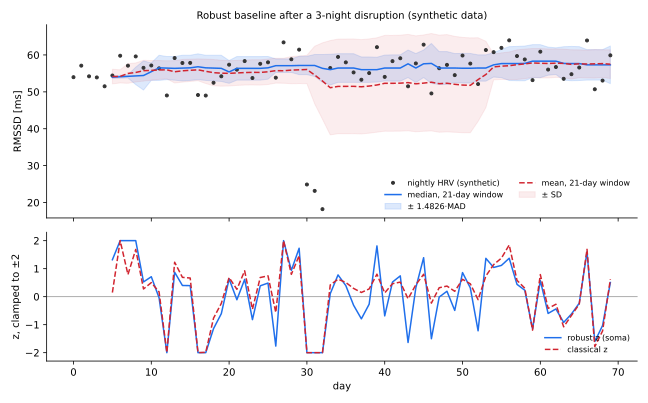

# bodyledger



<sub>Synthetic, seeded data from [`docs/robust_baseline.py`](docs/robust_baseline.py), using the same `_median` / `_mad` as the scorer.</sub>

A local-first store for wearable data. It pulls COROS and Google Health (Fitbit) data into one SQLite file under a fixed vocabulary of metric names and units, computes a daily readiness estimate, and exposes it through a CLI, a read-only MCP server, a local dashboard and a plain JSON file. The baseline is median/MAD over your own last 21 days, because with mean/SD a 3-night disruption widens the band for three weeks and ordinary low nights stop being flagged (figure above).

## Usage

macOS only (credentials live in the Keychain via `security(1)`). Python 3.10+, standard library only; `pytest` for the tests.

```sh
git clone https://github.com/Tommycode3/bodyledger && cd bodyledger
python3 -m pytest tests/              # 68 tests, no network, no credentials

python3 -m soma auth coros            # email + password -> Keychain
python3 -m soma auth google --client-id <id>.apps.googleusercontent.com
python3 -m soma sync                  # fetch, store, write ~/.soma/today.json
python3 -m soma status                # readiness + the facts behind it
python3 -m soma doctor                # what is connected, what is stale, what is missing
python3 -m soma metric sleep.duration_min --days 60
python3 -m soma metrics               # canonical vocabulary + real coverage per source
python3 -m soma events --kind workout
python3 -m soma insight               # pre-registered hypotheses, FDR-controlled
python3 -m soma dashboard             # http://127.0.0.1:4748
```

`bash scripts/install.sh` optionally adds a `~/bin/soma` wrapper, three LaunchAgents (sync every 15 min over the last 3 days, a deep 90-day sync at 04:20, an always-on dashboard) and registers the MCP server with the `claude` CLI if present. `scripts/uninstall.sh` removes them and leaves the data in `~/.soma`.

Fitbit data now goes through the Google Health API; the Fitbit Web API was scheduled for shutdown in September 2026 and old tokens do not carry over. In the Google Cloud console, enable the Google Health API, add yourself as test user on an External consent screen, create a "Desktop app" OAuth client (or "Web application" with redirect `http://localhost:8731/callback`), and set publishing status to In production. Left in Testing, Google revokes the refresh token after 7 days, and soma turns the resulting `invalid_grant` into that remedy. The legacy adapter (`soma auth fitbit`) is skipped automatically when Google Health is connected.

## How it works

Every source is translated once, at the edge, into rows `(source, metric, ts, day, value)`. COROS reports calories in thousandths of a kcal and Google Health sends int64 values as strings, and none of that leaks past the adapter. The `METRICS` table in `soma/store.py` is the contract: an adapter cannot write a metric not declared there with its unit. The primary key `(source, metric, ts)` makes re-syncing idempotent, and overnight metrics are dated by the wake-up day using the UTC offsets the API returns, not the machine's current time zone. SQLite is the source of truth; an optional Supabase replica is written one-way.

For a component $x$ (sleep duration, nightly RMSSD, resting HR, sleep efficiency) on day $t$, the baseline uses the previous 21 days $H_t$, requires $|H_t| \ge 5$, and gives

$$
z_t = s \cdot \frac{x_t - \operatorname{median}(H_t)}{\max\bigl(1.4826 \cdot \operatorname{MAD}(H_t),\ 10^{-6}\bigr)}, \qquad s = -1 \text{ for resting HR, else } +1.
$$

The 1.4826 makes the MAD consistent for $\sigma$ under normality, so $z$ reads like a classical z-score with a 50% breakdown point instead of 0%. Readiness weights the components 0.35 / 0.30 / 0.20 / 0.15 over the set $U$ that have a usable $z$. Missing inputs are excluded and declared, never imputed: if the evidence $E = \sum_{i \in U} w_i$ is below 0.4, you get the facts and no score. Otherwise

$$
R = \operatorname{round}\Bigl(\operatorname{clip}_{[0,100]}\Bigl(50 + 22 \cdot \frac{\sum_{i \in U} w_i \operatorname{clip}_{[-2,2]}(z_i)}{E}\Bigr)\Bigr),
$$

so $R \in [6, 94]$ in practice and no single night dominates. The posture in `today.json` is `neutral` when $E < 0.4$, `gentle` for $R < 38$, `challenging` for $R > 68$, `normal` otherwise. Training load is summarized as the acute:chronic ratio of daily `training.load`, reported only with at least 3 training days in 28 and flagged above 1.5 or below 0.7:

$$
\mathrm{ACWR}_t = \frac{\sum_{k=0}^{6} L_{t-k}}{\tfrac{1}{4}\sum_{k=0}^{27} L_{t-k}}
$$

`soma insight` tests a fixed list of 7 hypotheses written before looking at the data, such as training load on day $t$ against HRV on day $t+1$. Each needs at least 20 paired days and gets Spearman's $\rho$ with a permutation p-value from circular shifts of the outcome, which keeps its autocorrelation:

$$
p = \frac{1 + \#\{\, s \in \{3, \dots, n-3\} : |\rho(x, y^{(s)})| \ge |\rho_{\mathrm{obs}}| \,\}}{1 + S}
$$

Shifts of 1-2 days are skipped because they leave the pairing almost intact. Survivors pass Benjamini-Hochberg at $q = 0.10$ over all tests run, and the report says how many were run. With months of daily data, few or no findings is the expected result.

`~/.soma/today.json` is the integration point: day, readiness, evidence, per-component value, baseline and z, what is missing, ACWR and posture. Any local program can read it, and if soma stops, the consumer sees a stale timestamp. The MCP server (`python3 -m soma mcp`, JSON-RPC over stdio) exposes `soma_today`, `soma_metric`, `soma_metrics` and `soma_events`, all read-only, as is the dashboard.

To add a device, write `soma/adapters/<name>.py` with `sync(store, days) -> str`, map its fields onto `store.METRICS`, and register it in `soma/__main__.py` (`cmd_sync`, `_default_sources`).

## Limitations

- Personal tool, tested on my own COROS and Fitbit devices. Not packaged; run with `python3 -m soma`.
- macOS only (Keychain, LaunchAgents).
- The COROS adapter uses the unofficial API behind the COROS app. It can break without notice and only exposes activities and training load.
- The legacy Fitbit adapter targets an API scheduled for shutdown in September 2026.
- The Google Health adapter is tested against recorded response shapes, not the live API.
- LaunchAgents run `sync --cloud`; without Supabase configured, the cloud step logs an error every run.
- Readiness weights and thresholds are hand-chosen, not fitted or validated against an outcome. Not a medical device.

MIT, see [LICENSE](LICENSE).
